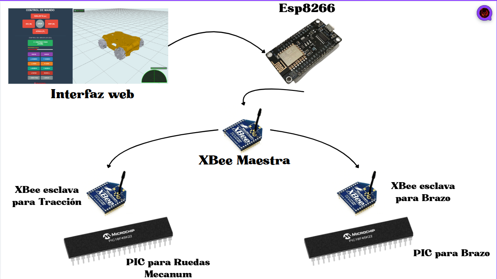

# Interconexión del Sistema

## 1. Visión general de la arquitectura

El sistema está compuesto por dos redes de comunicación independientes y de naturaleza distinta, unidas por un puente de traducción:

**Red 1** — WiFi/WebSocket: conecta a la persona (navegador) con el ESP8266. Es bidireccional, orientada a mensajes, y es donde vive el gemelo digital (la telemetría que anima el modelo URDF en Three.js).

**Red 2** — XBee (RF, maestro-esclavo): conecta al ESP8266 con los dos microcontroladores PIC. Es la red “de campo”: sin ella, nada se mueve. Es intencionalmente simple — un XBee maestro retransmite por aire lo que recibe por UART del ESP8266, y cada XBee esclavo entrega por UART a su propio PIC exactamente lo que escucha del maestro.

El ESP8266 es el único punto donde las dos redes se tocan: traduce JSON/texto de WebSocket a bytes planos de UART, y viceversa con la telemetría.

## 2. Por qué dos PIC en vez de uno

Se usó un microcontrolador dedicado por subsistema (chasis y brazo) en vez de centralizar todo en un solo PIC, por tres razones:

Carga de tiempo real independiente: el chasis corre un lazo de control PID a 20 Hz (cada 50 ms) por cada una de las 4 ruedas más el PID de rumbo con la IMU; el brazo gestiona el protocolo serial de los servos LewanSoul. Mezclar ambos en un solo lazo principal habría introducido jitter cruzado — el mismo problema de timing que ya se diagnosticó y corrigió dentro del propio chasis (ver Caracterizacion_de_las_Constantes_PID_Kp_Ki_Kd/) se habría multiplicado al compartir CPU con una tarea no relacionada.
Aislamiento de fallos: un error de firmware o un bloqueo en el control del brazo no puede colgar el control del chasis (y viceversa). Son placas físicamente distintas, alimentadas por baterías distintas (3S 5200 mAh el chasis, 2S 8000 mAh el brazo).
Comunicación exclusivamente por protocolo serial, nunca por PWM directo entre placas — ningún PIC controla una señal física del otro subsistema; toda la coordinación pasa por los bytes que viajan por XBee.

## 3. La red XBee: topología maestro-esclavo

Un módulo XBee configurado como Maestro recibe por UART lo que el ESP8266 le transmite y lo retransmite por RF. Dos módulos XBee configurados como Esclavos, uno junto a cada PIC, reciben esa transmisión y la entregan por su propia UART al microcontrolador correspondiente.

Punto pendiente de verificación (no resuelto todavía): para que el maestro pueda dirigirse de forma selectiva a un esclavo sin que el otro también reciba y reaccione al mismo mensaje, los dos esclavos deberían estar en canales RF y/o PAN ID distintos, o el mensaje debería llevar una dirección/encabezado que cada PIC filtre en firmware. Esta separación no ha sido confirmada en el proyecto hasta la fecha de este documento. Se deja registrado aquí como una verificación de hardware pendiente, no como un hecho ya comprobado — ver también la nota correspondiente en Especificaciones_Iniciales_de_Hardware.md.

Esto no es un detalle menor: es precisamente la razón detrás de la decisión documentada en la sección 5.

## 4. El puente ESP8266: WiFi ↔ UART

El ESP8266 corre un servidor WebSocket. Cada mensaje de control que llega desde la interfaz web se retransmite tal cual (o con una traducción mínima de formato) por su UART hacia el XBee Maestro. En sentido inverso, la telemetría que cada PIC reporta por su XBee esclavo llega al maestro, de ahí al ESP8266 por UART, y el ESP8266 la empuja por WebSocket hacia el navegador, donde alimenta la animación del gemelo digital en tiempo real.

El ESP8266 actúa como un bridge transparente de protocolo (WiFi↔serial), no como un controlador: no interpreta ni valida los comandos de movimiento, solo los transporta.

## 5. Coexistencia de dos protocolos de comando para el chasis

Esta es la sección más importante de este documento desde el punto de vista de ingeniería de software, porque refleja una decisión de diseño deliberada, no un descuido.

### 5.1 El origen del problema

La interfaz web original (primera etapa del proyecto) fue construida para un firmware de chasis mucho más simple, y define su Modo Manual con un protocolo de un solo carácter por botón:

Botón	Carácter enviado	Acción original
Avanzar	F	Vy positivo
Retroceder	B	Vy negativo
Lateral izquierda	L	Vx negativo
Lateral derecha	R	Vx positivo
Rotar izquierda	1	Wz negativo
Rotar derecha	2	Wz positivo
Detener	S	Todo a cero

El firmware de chasis evolucionó completamente (ver Firmware_PIC_Chasis/, Capas 0 a 4) hasta un protocolo de comandos con valor numérico explícito — Y<rpm>, X<rpm>, W<rpm>, más todo el set de diagnóstico y ajuste de ganancias (DI/DD/TI/TD, P/I/D, G/K/Q, J, C/Z/N). Este protocolo nuevo es necesario para el control fino (velocidad exacta en RPM) y para la caracterización/diagnóstico, pero no es el que usa el botón de Modo Manual de la interfaz web, que nunca fue reescrita para enviar ese formato.

### 5.2 Decisión adoptada: mantener ambos protocolos activos a la vez

Se decidió no modificar la interfaz web y en su lugar hacer que el firmware del chasis (Capa 4) entienda simultáneamente:

El protocolo nuevo, numérico, para control fino, telemetría y diagnóstico.
El protocolo viejo de un solo carácter, exclusivamente para el Modo Manual.

Esto evita reescribir y volver a validar la interfaz web (que ya funciona y ya está integrada con el gemelo digital), y mantiene el Modo Manual como una vía de control simple e inmediata, independiente del protocolo más complejo usado por el resto del sistema.

### 5.3 Conflictos de letras detectados y resueltos

Al tener dos protocolos activos sobre el mismo canal UART, aparecieron dos riesgos concretos que se resolvieron antes de habilitar la compatibilidad:

(a) Colisión directa de letra — F. En el protocolo nuevo, F<n> fijaba la ganancia integral del PID de rumbo (Kih). En el protocolo viejo, F (sin número) significa “avanzar”. No pueden coexistir con el mismo significado. Solución: el comando de Kih se reasignó a la letra Q.

(b) Colisión potencial entre placas — H. El PIC del brazo usa H para comandar HOME. En el firmware del chasis, H1/H0 activaba o desactivaba el mantenimiento de rumbo. Dado que la separación de canal/PAN ID entre los dos XBee esclavos no está confirmada (sección 3), existe el riesgo de que un comando H dirigido al brazo también sea recibido por el PIC del chasis y altere el estado del hold de rumbo sin que el usuario lo pida. Solución, por seguridad independientemente de si los canales ya están separados: el comando de hold de rumbo del chasis se reasignó a la letra J.

(c) Ambigüedad de dígitos — 1 y 2. Si 1 y 2 dispararan rotación de forma incondicional, se reintroduciría exactamente el mismo bug ya corregido en la Capa 0 del firmware (ver Caracterizacion_de_las_Constantes_PID_Kp_Ki_Kd/): un comando como Y120 quedaría interpretado a mitad de camino como “rotar” en cuanto el parser viera el primer 1. Solución: 1 y 2 solo se interpretan como comandos de rotación del Modo Manual cuando el parser no está a mitad de capturar el valor numérico de otro comando. Si ya hay una captura en curso, se tratan como dígitos normales, igual que cualquier otro número.

### 5.4 Tabla final de comandos del chasis (post-reconciliación)

| Letra | Significado | Protocolo |
| :--- | :--- | :--- |
| `Y<rpm> / X<rpm> / W<rpm>` | Vy / Vx / Wz con valor exacto | Nuevo |
| `DI/DD/TI/TD<rpm>` | Rueda individual (diagnóstico) | Nuevo |
| `P/I/D<n>` | Ganancias PID de rueda | Nuevo |
| `G/K/Q<n>` | Ganancias PID de rumbo (antes F para Kih) | Nuevo |
| `J1/J0` | Hold de rumbo on/off (antes H1/H0) | Nuevo |
| `C / Z / N` | Calibrar / zero / invertir rumbo | Nuevo |
| `F / B / L / R` | Avanzar / retroceder / lateral izq / lateral der (magnitud fija) | Viejo – Modo Manual |
| `1 / 2` | Rotar antihorario / horario (magnitud fija, solo sin captura en curso) | Viejo – Modo Manual |
| `S` | Detener todo | Compartido (sin cambios) |

## 6. Latencia y consideraciones de la ruta completa

Un comando originado en un clic del navegador recorre: WebSocket → ESP8266 → UART → XBee Maestro → aire (RF) → XBee Esclavo → UART → PIC. Cada salto agrega una latencia pequeña pero no nula; no se ha medido formalmente el round-trip completo en este proyecto — se deja anotado como una métrica pendiente de caracterizar si se documenta más adelante.