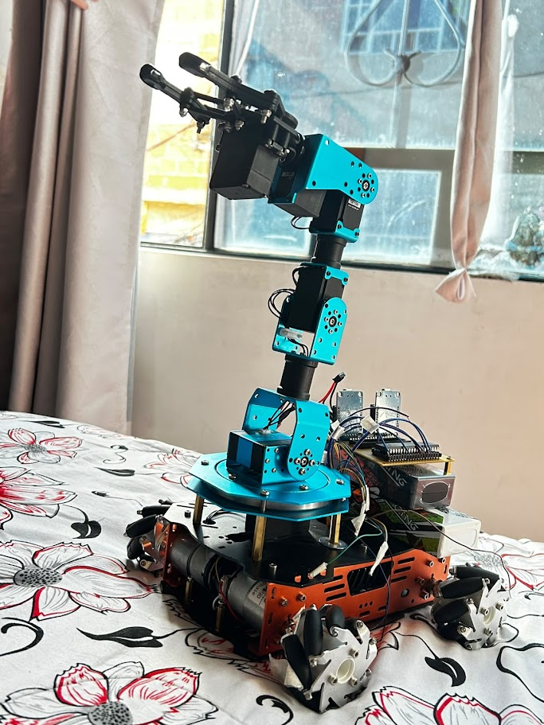

Este repositorio documenta el progreso, las simulaciones de SolidWorks y el código para el desarrollo de un vehículo omnidireccional integrado con un brazo robótico, además de la comunicación con los distintos elementos del sistema.

## 🎯 Meta del Proyecto

Lograr la integración funcional y el control inalámbrico entre un chasis de tracción omnidireccional y un brazo robótico manipulador de 5 DOF. El proyecto se sustenta en una arquitectura de control distribuida y la implementación de un entorno de simulación virtual, garantizando un diseño mecánico optimizado y operaciones precisas, con miras a una navegación autónoma por coordenadas cartesianas.

## Arquitectura de Control Distribuido

Control independiente mediante microcontroladores PIC18F45K22 dedicados: uno para la tracción del chasis (4× puente H BTS7960, motores GM37-520 con encoder en cuadratura) y otro para la manipulación del brazo xArm1S (servos LX-15D/LX-225), comunicados estrictamente mediante protocolo UART, omitiendo el uso directo de señales PWM entre placas.

## Red de Telecomunicaciones (Topología Maestro-Esclavo)

Implementación de una red de radiofrecuencia mediante módulos XBee. Un XBee "Maestro" distribuye las órdenes hacia los XBee receptores ubicados en cada subsistema (chasis y brazo, un XBee por cada PIC).

## Interfaz de Usuario y Puente IoT

El módulo XBee Maestro recibe sus instrucciones desde un ESP8266 NodeMCU, que actúa como puente WiFi mediante un servidor WebSocket. Este recibe los comandos en tiempo real desde una interfaz web (HTML/JavaScript/Three.js).

## Implementación de Gemelo Digital

La interfaz web no solo envía comandos: integra y visualiza los modelos URDF del carro y el brazo. Actúa como un Gemelo Digital donde los movimientos físicos (rotación de llantas, articulaciones del brazo) se simulan y reflejan de manera sincronizada en el entorno virtual, a partir de la telemetría real reportada por los PIC.

---

## 📁 Estructura del repositorio

| Carpeta | Contenido |
|---|---|
| `Firmware_PIC_Chasis/` | Código fuente completo del PIC de tracción: evolución desde el diagnóstico de encoders (Capa 0) hasta el control simultáneo de las 4 ruedas con PID + feedforward + mantenimiento de rumbo (Capa 4). |
| `Firmware_PIC_Brazo/` | Código del PIC del manipulador: protocolo LewanSoul, bus half-duplex, telemetría del gemelo digital. |
| `Mantenimiento_de_Rumbo_MPU9250/` | Integración del giroscopio MPU9250 vía I2C: driver, calibración de sesgo, PID de corrección de rumbo con anti-windup. |
| `Caracterizacion_de_las_Constantes_PID_Kp_Ki_Kd/` | Metodología y datos de la caracterización experimental: curvas de feedforward por rueda, sintonización del PID. |
| `Especificaciones_del_Motor_y_Resolucion_Espacial/` | Datasheet de los motores GM37-520, deducción empírica de la constante de pulsos por vuelta del encoder. |
| `Cinematica_Inversa/` | Deducción de la matriz de cinemática inversa Mecanum (Vx, Vy, Wz → velocidad de cada rueda). |
| `Acondicionamiento_Xbee/` | Diagrama y justificación del bus half-duplex (diodo + pull-up) para la comunicación con los servos. |
| `Gemelo Digital_Interfaz_Web-y-Servidor_ESP8266/` | Interfaz web (Three.js + URDF) y firmware del puente ESP8266 (WebSocket ↔ UART). |
| `Diseno_CAD_SolidWorks/` | Modelos y ensamblajes mecánicos. |
| `Exportacion_De_URDF/` | Proceso de exportación del modelo URDF desde SolidWorks. |
| `Odometria_y_Control_de_Posicion/` | *(En desarrollo)* Calibración de pulsos→cm y control de posición para navegación por coordenadas. |

---

## 🗺️ Estado del proyecto (hoja de ruta técnica)

- [x] Caracterización experimental de motores y encoders (constante de 1090 pulsos/vuelta)
- [x] Curvas de feedforward individuales por rueda y por dirección
- [x] PID de velocidad por rueda, validado individualmente
- [x] Cinemática inversa Mecanum funcionando (avance, lateral, diagonal, rotación)
- [x] Diagnóstico y corrección de asimetría mecánica (deriva en lateral)
- [x] Integración del MPU9250 y mantenimiento de rumbo (PID con anti-windup)
- [ ] Odometría: calibración pulsos→cm (lateral y frontal por separado)
- [ ] Control de posición: navegación a coordenada (X, Y) específica
- [ ] Integración completa con el gemelo digital en tiempo real

---

## 🎥 Demostraciones

*(Videos de las pruebas de movimiento lateral, corrección de rumbo y el gemelo digital — ver `docs/videos/` o los enlaces a continuación)*

---

## 🛠️ Stack tecnológico

- **Firmware:** C (XC8), PIC18F45K22 ×2
- **Comunicación:** UART, I2C, XBee (RF), WebSocket
- **Interfaz:** HTML / JavaScript / Three.js (urdf-loader)
- **Puente IoT:** ESP8266 (Arduino framework)
- **Diseño mecánico:** SolidWorks

---

**Autor:** Jaider Esteban Medina Rubio
